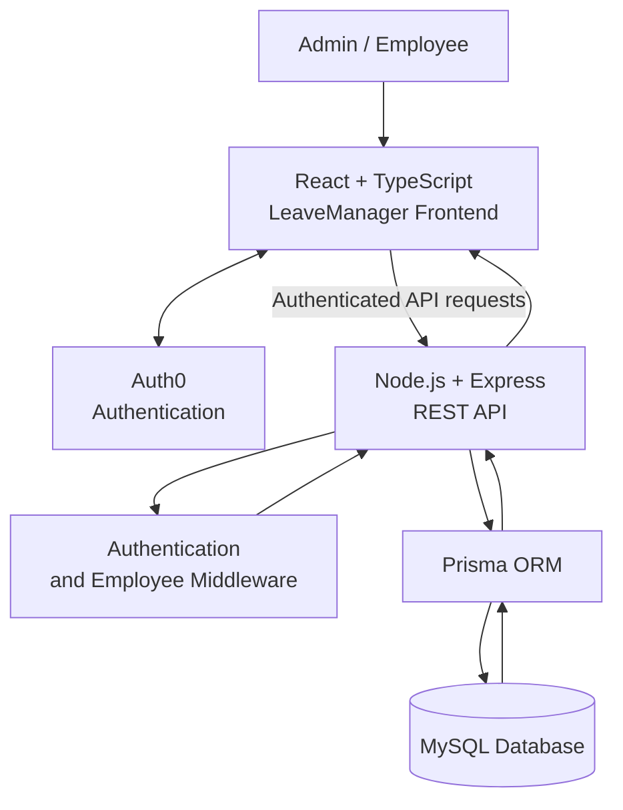

# LeaveManager – Leave Management System

LeaveManager is a web-based Leave Management System developed to simplify and organize employee leave management within an organization. It provides separate dashboards for employees and administrators, allowing employees to submit and track leave requests while administrators manage requests and monitor employee leave balances.

The application uses **Auth0 for authentication**, **Node.js and Express for backend APIs**, **Prisma ORM for database access**, and **MySQL for persistent data storage**.

## Project Overview

Managing employee leave manually can be time-consuming and difficult to track. LeaveManager aims to provide a centralized platform where employees can apply for leave, view their leave history and check available leave balances, while administrators can review and manage leave requests efficiently.

The system follows a role-based approach with two user roles:

- **Employee:** Can access personal information, submit leave requests, view request status and check leave balances.
- **Admin:** Can manage employee leave requests, review pending applications, approve or reject requests and oversee leave information.

## Features

### Authentication and Authorization
- Secure user authentication using Auth0.
- Auth0 user identity mapped to employee records in the database.
- Role-based access control for Admin and Employee users.
- Protected backend API endpoints.
- Employees can access only their own leave-related information.

### Employee Dashboard
- View employee profile information.
- Submit new leave requests.
- Select leave type and leave dates.
- Provide a reason for leave.
- View submitted leave requests.
- Track leave request status.
- View available leave balances.

### Leave Request Management
- Create leave requests with start date, end date and reason.
- Calculate leave duration based on working days.
- Exclude Saturdays and Sundays from the working-day calculation.
- Maintain leave request statuses:
  - Pending
  - Approved
  - Rejected
  - Cancelled
- Retrieve leave request details from the backend.

### Admin Dashboard
- View leave requests submitted by employees.
- Review pending leave applications.
- View requests based on their status.
- Approve or reject leave requests.
- Create leave requests on behalf of employees.
- Monitor employee leave information.

### Leave Balance Management
- Maintain leave balances for different leave types.
- Track total leave days and used leave days.
- Calculate remaining leave balance.
- Maintain leave balances by employee, leave type and year.
- Update leave usage when leave requests are approved.

### Database Management
- Store employee details and roles.
- Maintain leave types and leave policies.
- Store leave requests and their approval information.
- Track employee leave balances.
- Use relational database constraints to maintain data consistency.

## Technology Stack

| Technology | Purpose |
|---|---|
| React | Frontend user interface |
| TypeScript | Type-safe frontend development |
| Vite | Frontend development server and build tool |
| Node.js | Backend JavaScript runtime |
| Express.js | REST API development |
| Auth0 | Authentication and identity management |
| Prisma ORM | Database access and query management |
| MySQL | Relational database |
| Swagger / OpenAPI | API documentation |

## System Architecture

LeaveManager follows a three-tier web application architecture.

1. **Presentation Layer:** React frontend responsible for dashboards, forms and user interaction.
2. **Application Layer:** Express backend responsible for API handling, authentication, authorization, validation and business logic.
3. **Data Layer:** MySQL database accessed through Prisma ORM for storing application data.

### Architecture Diagram



## Authentication Flow

1. The user opens LeaveManager and initiates login.
2. Auth0 authenticates the user.
3. The frontend obtains an access token for the LeaveManager API.
4. The frontend sends the token with API requests.
5. The backend verifies the token using authentication middleware.
6. The authenticated Auth0 identity is mapped to an employee record.
7. The employee's role determines which operations are permitted.

## Database Entities

The application uses the following main database entities:

### Employee
Stores employee information, including employee ID, name, email, department, role and Auth0 identity.

### LeaveType
Stores available leave categories, including leave name, description, default leave days and paid/unpaid information.

### LeaveRequest
Stores employee leave applications, including leave type, dates, number of working days, reason, status, approving manager and comments.

### LeaveBalance
Stores leave entitlement and usage for each employee, leave type and year.

## API Overview

The backend exposes REST APIs for employee profiles, leave requests and leave balances.

| Method | Endpoint | Description |
|---|---|---|
| GET | `/api/users/me` | Get the logged-in employee profile |
| GET | `/api/leave-requests/me` | Get the employee's leave requests |
| POST | `/api/leave-requests/me` | Submit a leave request |
| GET | `/api/leave-requests` | Admin: retrieve all leave requests |
| GET | `/api/leave-requests?status=PENDING` | Admin: retrieve requests by status |
| GET | `/api/leave-requests/:id` | Retrieve a leave request by ID |
| POST | `/api/leave-requests` | Admin: create a request for an employee |
| PATCH | `/api/leave-requests/:id/status` | Admin: approve or reject a request |
| GET | `/api/leave-balances/me` | Get the employee's leave balances |
| GET | `/api/leave-balances/:id` | Admin: retrieve an employee's leave balances |

## Project Structure

```text
Leave-Management-System/
│
├── lms-fe/                 # React frontend
│   ├── src/
│   │   ├── pages/          # Application pages and dashboards
│   │   ├── services/       # API service functions
│   │   └── ...
│   └── package.json
│
├── lms-be/                 # Express backend
│   ├── prisma/             # Prisma schema and database files
│   ├── src/
│   │   ├── config/         # Database configuration
│   │   ├── middleware/     # Authentication and employee middleware
│   │   ├── routes/         # API route handlers
│   │   ├── server.js       # Backend entry point
│   │   └── swagger.js      # API documentation configuration
│   ├── .env.example
│   └── package.json
│
├── README.md
└── package.json
```

## Getting Started

### Prerequisites

Make sure the following are installed:

- Node.js and npm
- MySQL
- Auth0 account
- Git

### 1. Clone the Repository

```bash
git clone <your-repository-url>
cd Leave-Management-System
```

### 2. Configure the Backend

```bash
cd lms-be
npm install
```

Create a `.env` file using the provided `.env.example` as a reference.

Configure the required database connection and Auth0 environment variables.

### 3. Configure the Database

Create a MySQL database for the project.

Configure Prisma using the project's database settings and apply the required database migrations or schema setup.

Generate the Prisma client if required by the project configuration.

### 4. Start the Backend

Run the backend development command defined in `lms-be/package.json`.

The backend development server is configured to run on:

```text
http://localhost:4000
```

### 5. Configure the Frontend

Open a new terminal:

```bash
cd lms-fe
npm install
```

Configure the frontend Auth0 settings in the frontend environment file, using the project's environment variable template.

### 6. Start the Frontend

Run the frontend development command defined in `lms-fe/package.json`.

The Vite development server is configured to run on:

```text
http://localhost:5173
```

## Future Enhancements

The following improvements can be considered as the project evolves:

- Complete and thoroughly test Admin request creation and approval workflows.
- Add leave request overlap validation.
- Add public holiday support to working-day calculations.
- Improve leave policy and balance validation.
- Add email notifications for request submission, approval and rejection.
- Add audit logs for administrative actions.
- Add employee search and advanced request filtering.
- Add automated backend API tests.
- Introduce organization-level multi-tenancy if the system is extended to support multiple companies.
- Deploy separate development, staging and production environments.

## Project Status

LeaveManager is currently being developed as a proof-of-concept Leave Management System.

The core application structure, authentication flow, employee and admin roles, database models and leave-related APIs have been developed. The Admin dashboard and persistence workflows are being integrated and tested.

## Learning Objectives

This project provides practical experience with:

- Full-stack web application development.
- React and TypeScript.
- REST API development using Express.
- Authentication and role-based authorization.
- Relational database design.
- Prisma ORM and MySQL.
- Frontend-backend integration.
- Environment configuration and application architecture.

---

**LeaveManager** — Simplifying employee leave management through a centralized and role-based web application.
